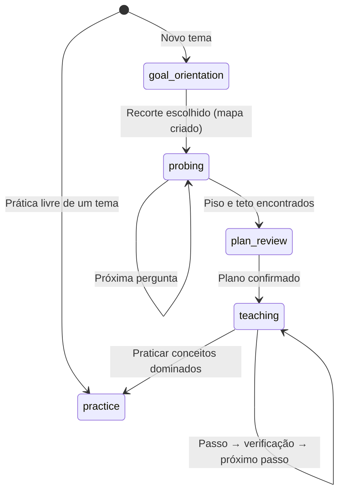

# APRENDA

> **"Fatos memorizados apodrecem. Fatos compreendidos permanecem."**

O **APRENDA** é um aplicativo desktop (Windows e Linux) que funciona como um tutor de IA que **descobre o que você já sabe antes de ensinar**. Em vez de despejar respostas ou repetir flashcards, ele mede a fronteira do seu conhecimento, encontra equívocos escondidos, ensina só o que falta, em passos curtos, e depois faz você praticar até o conceito vir à cabeça sozinho.

Você escolhe o provedor de IA (OpenRouter, Google, OpenAI, Anthropic, Ollama local e outros) e usa a sua própria chave.

---

## Sumário

- [Como funciona](#-como-funciona)
- [As fases de uma sessão](#-as-fases-de-uma-sessão)
- [Recursos](#-recursos)
- [Provedores de IA](#-provedores-de-ia)
- [Como executar](#-como-executar)
- [Arquitetura](#-arquitetura)
- [Testes e qualidade](#-testes-e-qualidade)
- [Licença](#-licença)

---

## 🧠 Como funciona

O método se apoia em alguns princípios simples:

1. **Medir antes de ensinar.** Ensinar o que você já domina é perda de tempo; ensinar além do que você consegue assimilar gera frustração. A sondagem localiza o ponto em que a compreensão passa de sólida para incerta.
2. **Verdades incondicionais primeiro.** Cada conceito parte de um princípio sem ressalvas, que dá para aceitar com segurança antes de construir em cima dele.
3. **"Como eu poderia ter descoberto isso?"** Nada aparece por decreto: cada passo é motivado por um problema concreto do passo anterior.
4. **Sem falsos positivos.** Acertar por chute esconde lacunas. Cada resposta vem com um grau de confiança (0–100%) e, se você quiser, com o seu raciocínio; o avaliador usa os dois para separar domínio real de adivinhação.
5. **Entender não basta: é preciso lembrar.** Depois da aula, a prática põe o conceito em situações diferentes da aula, até ele vir à mente sem ajuda.

Cada conceito do mapa recebe um estado:

| Estado | Significado |
| --- | --- |
| 🟢 **Domínio** (`mastered`) | Acerto com confiança e raciocínio correto. |
| 🟡 **Falso positivo** (`false_positive`) | Acerto com justificativa frágil ou chute. |
| 🔴 **Ponto cego** (`blind_spot`) | Erro sustentado com alta convicção. |
| 🔵 **Fronteira** (`frontier`) | Lacuna honesta, na borda do que você já assimila. |

---

## 🔄 As fases de uma sessão

A sessão é conduzida por uma máquina de estados (`SessionStateMachine`):



1. **Orientação (`goal_orientation`)** — você diz o que quer aprender (ex.: *"TCP e UDP"*). A IA propõe recortes do tema; você escolhe um, escreve o seu ou pede pontos de entrada mais simples. O recorte vira um mapa de conceitos com pré-requisitos.
2. **Sondagem (`probing`)** — perguntas de múltipla escolha com controle de confiança e campo para o raciocínio (ou resposta livre).
   - Começa **no topo** do mapa, pelo conceito mais alto que o objetivo exige. Um acerto dá por sabido o que está abaixo; um erro desce dividindo o intervalo ao meio.
   - Um acerto no topo ganha uma segunda pergunta, mais difícil, antes de contar.
   - A sondagem termina quando cada linha do mapa tem piso e teto definidos (há um mínimo de perguntas configurável), e cada linha recebe um resumo com equívocos encontrados.
3. **Plano (`plan_review`)** — a IA propõe a ordem das aulas a partir do que a sondagem revelou, sempre do conceito mais básico para o mais alto. Você confirma.
4. **Aulas (`teaching`)** — cada conceito é ensinado em até quatro passos:
   - **Palpite**: você formula uma intuição antes da teoria. Se o palpite já contém o conceito e o mecanismo, a aula vira uma única confirmação.
   - **Explicação + verificação** por passo. Errou? O mesmo passo é explicado de novo a partir do diagnóstico, até duas vezes.
   - O conceito só fica dominado quando o último passo é demonstrado.
   - Se um passo resiste às duas tentativas, o plano pode **ganhar um fundamento que faltava** no mapa (no máximo dois por revisão e quatro por sessão), ensinado antes. Você é avisado do que mudou.
5. **Prática (`practice`)** — problemas novos sobre o que já foi dominado:
   - A solução modelo é definida antes do problema e só aparece quando ele termina.
   - Dicas em escada (R0 a R5), uma por pedido.
   - Os alvos se alternam; os modos avançam de recordação para discriminação e composição; a dificuldade acompanha o último resultado.
   - No fechamento, tudo o que falhou volta em uma situação nova. A sessão termina quando não há nada pendente.

Se a IA falhar em qualquer ponto, nada é inventado: o erro aparece junto do campo, e você pode tentar de novo ou cancelar sem perder o que já fez.

---

## ✨ Recursos

- **Mapa de conceitos** com layout de forças (d3-force), cores por estado e painel de detalhes de cada conceito.
- **Notas por conceito**: o que você já aprendeu e o que falta, escritas a partir do que você fez; ficam marcadas como desatualizadas quando o progresso muda.
- **Memória entre sessões**: cada conceito dominado numa aula ou resolvido sem ajuda na prática fica registrado com a data. Novos mapas marcam o que você já demonstrou, e a sondagem não desce abaixo disso. Uma tela de memória permite ver, apagar e praticar o que foi guardado.
- **Sessões salvas** na barra lateral: renomear, fixar, apagar; uma aula fechada no meio reabre no mesmo passo.
- **Conversa em rolagem única**, com as perguntas respondidas e as aulas concluídas disponíveis para releitura.
- **Nota do tutor** (`AgentThinkingBlock`) recolhível e atualizada em tempo real.
- **Markdown, código e matemática**: tabelas, listas, blocos de código com destaque e fórmulas em KaTeX.
- **Ditado por voz** ao vivo com Deepgram (com transcrição parcial na tela) ou pela Web Speech API.
- **Interface em português e inglês**; as respostas da IA seguem o idioma escolhido.
- **Modelo e nível de raciocínio** (*Off*, *Low*, *Medium*, *High*) selecionáveis, com preço e janela de contexto de cada modelo.
- **Modo de economia para planos gratuitos**: desliga a pré-geração em segundo plano das próximas perguntas, gastando menos requisições.

---

## 🔌 Provedores de IA

OpenRouter · Google Gemini · OpenAI · Anthropic · DeepSeek · Groq · Cerebras · Together AI · Mistral AI · Ollama (local) · endpoint compatível com OpenAI personalizado.

As chaves são guardadas **criptografadas** no processo principal (via `safeStorage` do Electron) e nunca chegam à interface. Os dados ficam na pasta de dados do aplicativo (`userData`): `sessions.json`, `memory.json` e `secrets.json`.

> **Planos gratuitos:** funcionam, mas o limite de requisições acaba rápido (chegar à primeira aula custa perto de 15 chamadas). Ative a economia de requisições nas configurações do modelo e prefira modelos rápidos.

---

## 🚀 Como executar

### Pré-requisitos

- **Node.js** 18 ou superior
- **npm** 9 ou superior

### Instalar

```bash
git clone https://github.com/eduardo-lucio/aprenda.git
cd aprenda
npm install
```

### Abrir o aplicativo

```bash
npm run build
npm start
```

Depois, abra **Configurações → Provedores**, cole a chave do provedor escolhido e selecione um modelo.

### Desenvolver a interface no navegador

```bash
npm run dev
```

Abre o Vite em `http://localhost:5173`. Com `?mock` no endereço (`http://localhost:5173/?mock`), a interface usa uma API simulada, sem Electron nem IA. Para abrir o Electron apontando para o Vite, defina `VITE_DEV_SERVER_URL=http://localhost:5173` antes de `npm start`.

### Gerar os instaláveis

```bash
npm run dist:linux   # release/APRENDA-<versão>-linux-x86_64.AppImage
npm run dist:win     # release/APRENDA-<versão>-windows-x64-setup.exe
npm run dist         # os dois
```

No Linux, o instalador de Windows precisa do Wine. Os prompts (`prompts/`) vão dentro do pacote, em `resources/prompts`. Os instaláveis não são assinados: o Windows pode mostrar o aviso do SmartScreen (*Mais informações → Executar assim mesmo*).

### Scripts

| Comando | O que faz |
| --- | --- |
| `npm run dev` | Servidor Vite da interface |
| `npm run build` | Compila interface e processo principal em `dist/` |
| `npm start` | Abre o Electron a partir de `dist/` |
| `npm test` | Roda os testes (Vitest) |
| `npm run lint` | ESLint em `src` e `tests` |
| `npm run typecheck` | Checagem de tipos sem gerar arquivos |
| `npm run dist*` | Gera os instaláveis em `release/` |

---

## 🏗 Arquitetura

Electron + TypeScript + React, em três camadas: processo principal, *preload* e interface.

```
aprenda/
├── prompts/                  # Doutrina pedagógica em Markdown (lida em tempo de execução)
│   ├── shared/               # Voz, precisão, modelo mental, confiança, formatação
│   ├── prober/               # Sondagem
│   ├── teacher/              # Método, planejamento, aulas, palpites, perguntas
│   └── practice/             # Prática
├── src/
│   ├── main/                 # Processo principal (Electron)
│   │   ├── fsm/              # SessionStateMachine e ProbeFrontier (escolha da próxima pergunta)
│   │   ├── ipc/              # Canais IPC
│   │   ├── knowledge/        # KnowledgeStore (mapa de conceitos)
│   │   ├── persistence/      # Sessões, memória do aluno e chaves criptografadas
│   │   ├── practice/         # PracticeEngine e practiceStream (sequência de problemas)
│   │   ├── prompts/          # Montagem dos prompts de cada agente
│   │   ├── socratic/         # SocraticEngine (palpite, passos e verificações)
│   │   └── services/         # Orquestrador, avaliador, currículo, notas, cliente de IA, provedores e voz
│   ├── preload/              # Ponte segura (window.api)
│   ├── renderer/             # Interface (React 18 + Vite + Tailwind)
│   │   ├── components/       # Cartões, mapa, notas, memória, configurações, RichText
│   │   ├── graph/            # Layout de forças e metadados de estado
│   │   ├── hooks/            # Ditado e notas de conceito
│   │   ├── i18n/             # Português e inglês
│   │   ├── views/            # SessionView e PracticeView
│   │   └── dev/              # API simulada para o modo ?mock
│   └── shared/               # Tipos e contratos de IPC
├── tests/                    # Vitest (processo principal e interface)
└── build/                    # Ícones dos instaláveis
```

### Tecnologias

- **Base**: [Electron](https://www.electronjs.org/) 45, [TypeScript](https://www.typescriptlang.org/), [Node.js](https://nodejs.org/)
- **Interface**: [React 18](https://react.dev/), [Vite](https://vitejs.dev/), [Tailwind CSS](https://tailwindcss.com/), [Lucide](https://lucide.dev/)
- **Conteúdo**: [react-markdown](https://github.com/remarkjs/react-markdown) + remark-gfm, [KaTeX](https://katex.org/), [d3-force](https://d3js.org/d3-force)
- **Testes**: [Vitest](https://vitest.dev/), [Testing Library](https://testing-library.com/), [jsdom](https://github.com/jsdom/jsdom)
- **Empacotamento**: [electron-builder](https://www.electron.build/) (AppImage e NSIS)

---

## 🧪 Testes e qualidade

```bash
npm test
npm run lint
npm run typecheck
```

São mais de 400 testes em 46 arquivos, cobrindo a máquina de estados, a sondagem, as aulas, a prática, a memória, os provedores, a recuperação de falhas e a interface. As chamadas de IA são simuladas (`tests/helpers/mockLLM.ts`), então os testes não gastam requisições.

---

## 📄 Licença

Propriedade privada. Todos os direitos reservados © 2026 Eduardo.
