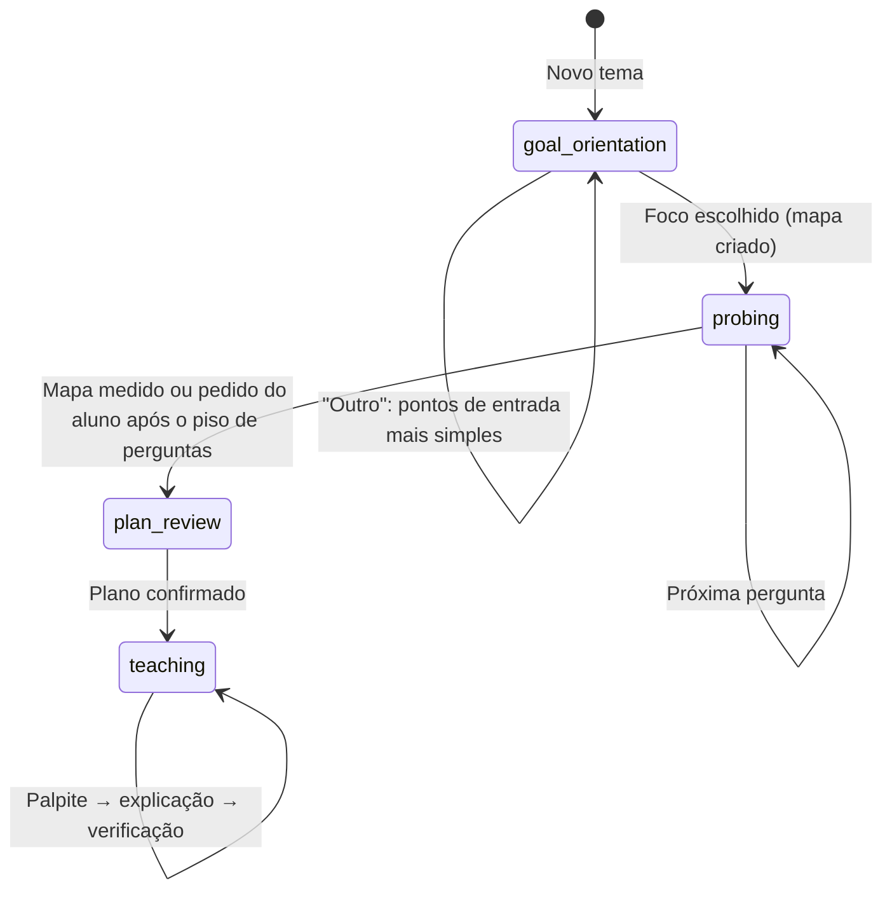

# APRENDA — EduCognitive Agent Harness

> **"Fatos memorizados apodrecem. Fatos compreendidos permanecem."**

O **APRENDA** é um ambiente de aprendizado acelerado e profundo conduzido por agentes de inteligência artificial. Ao contrário de chatbots convencionais que apenas fornecem respostas ou sistemas de flashcards baseados em repetição mecânica, o APRENDA atua como um **tutor socrático cirúrgico**: ele mapeia a exata fronteira do conhecimento do estudante, diagnostica equívocos conceituais ocultos e conduz uma jornada estruturada de descoberta motivada até a consolidação do entendimento.

---

## 🧠 Filosofia Pedagógica e Cognitiva

O design do APRENDA é fundamentado em princípios avançados de ciência cognitiva e pedagogia ativa:

1. **A Fronteira Cognitiva (Medir antes de Ensinar)**:
   - Ensinar o que o estudante já domina é perda de tempo; ensinar além do que ele consegue assimilar gera frustração e evasão.
   - O sistema realiza uma busca binária no espaço conceitual para encontrar o ponto exato onde a compreensão transita de sólida para incerta (a *Fronteira*).
2. **O "Click" Estrutural (Fatos Soltos $\rightarrow$ Estruturas Geradoras)**:
   - O estudante chega com intuições desconectadas. O tutor ancora verdades fundamentais e desenha conexões passo a passo até que essas intuições colapsem em uma estrutura lógica evidente por si mesma.
3. **Princípio I: Verdades Incondicionais Primeiro**:
   - Princípios sólidos, sem ressalvas ou exceções prematuras, que o cérebro pode aceitar com 100% de segurança antes de construir camadas superiores de abstração.
4. **Princípio II: "Como eu poderia ter descoberto isso?"**:
   - Inspirado na abordagem explicativa do *3Blue1Brown* (Grant Sanderson): o conhecimento nunca surge arbitrariamente por decreto. Cada etapa é motivada por um problema concreto anterior.
5. **Eliminação de Falsos Positivos**:
   - Acertar uma questão de múltipla escolha por chute ou eliminação mascara lacunas graves. O APRENDA exige a calibração de certeza (0–100%) e a explicação do raciocínio, permitindo ao Juiz Cognitivo separar domínio genuíno de adivinhações.

---

## 🔄 As 4 Fases da Sessão (Máquina de Estados)

A jornada de aprendizado é governada por uma Máquina de Estados Finitos rigorosa (`SessionStateMachine`):



1. **`goal_orientation` (Orientação de Escopo)**:
   - O estudante digita o que quer aprender (ex.: *"Eu quero aprender sobre TCP/UDP"*).
   - A IA propõe recortes do tema. O aluno escolhe um, escreve o próprio ou pede orientação.
2. **`probing` (Diagnóstico de Fronteira)**:
   - Perguntas com alternativas, controle de confiança e campo para explicar o raciocínio.
   - Cada resposta classifica o conceito no mapa:
     - 🟢 **Domínio Sólido (`mastered`)**: Acerto com alta confiança e fundamentação correta.
     - 🟡 **Falso Positivo (`false_positive`)**: Acerto com justificativa frágil ou chute.
     - 🔴 **Ponto Cego (`blind_spot`)**: Erro sustentado com alta convicção.
     - 🔵 **Fronteira Ativa (`frontier`)**: Lacuna honesta, na borda do que o aluno assimila.
3. **`plan_review` (Plano de Estudo)**:
   - A IA propõe a ordem das aulas a partir do que a sondagem revelou, e o aluno confirma.
4. **`teaching` (Aulas)**:
   - **Palpite**: O aluno formula uma intuição antes da teoria.
   - **Explicação**: Texto curto que resolve o palpite a partir da verdade incondicional do conceito.
   - **Verificação**: Pergunta de aplicação. As aulas concluídas ficam na conversa para releitura.

Se a IA falhar, nada é inventado: o aluno vê o erro junto do campo e pode tentar de novo ou cancelar.

---

## 🏗 Arquitetura do Software

O projeto é estruturado em uma arquitetura limpa de 3 camadas com **Electron**, **TypeScript** e **React**:

```
aprenda1/
├── prompts/                   # Doutrina pedagógica em Markdown
├── src/
│   ├── main/                  # Processo principal (Electron)
│   │   ├── fsm/               # SessionStateMachine
│   │   ├── ipc/               # Canais IPC
│   │   ├── knowledge/         # KnowledgeStore (mapa de conceitos em memória)
│   │   ├── persistence/       # SessionRepository e SecretStore (chaves criptografadas)
│   │   ├── prompts/           # Montagem dos prompts de cada agente
│   │   ├── socratic/          # SocraticEngine (palpite, explicação e verificação)
│   │   └── services/          # Orquestrador, juiz, gerador de currículo, cliente de IA, provedores e voz
│   ├── preload/               # Context bridge (window.api)
│   ├── renderer/              # Interface (React 18 + Vite + Tailwind)
│   │   ├── components/        # Cards, mapa, RichText (Markdown + código + KaTeX), configurações
│   │   ├── graph/             # Layout radial e metadados de status
│   │   ├── hooks/             # useSpeechRecognition (Deepgram / Web Speech)
│   │   ├── i18n/              # Textos em português e inglês
│   │   ├── lib/               # Tratamento de erros para exibição
│   │   └── views/             # SessionView (conversa e fluxo da sessão)
│   └── shared/                # Tipos e contratos de IPC
├── tests/                     # Vitest (processo principal e interface)
├── eslint.config.mjs
├── package.json
└── vite.config.ts
```

---

## 🎨 Principais Recursos de Interface (UI/UX)

- **Chat Contínuo de Rolagem Única**:
  - Toda a linha do tempo (mensagens do usuário, pensamentos da IA, histórico de perguntas e questão ativa) convive em um fluxo unificado sem scrolls internos truncados.
- **Questão Acoplada ao Input**:
  - A alternativa selecionada e o campo de texto de raciocínio são integrados. Se o aluno digita sem escolher alternativa, o sistema entende como resposta dissertativa própria.
- **Blocos de Pensamento do Agente (`AgentThinkingBlock`)**:
  - Exibe a nota do tutor de forma colapsável, com atualização em tempo real sem roubar o scroll da tela.
- **Markdown, Código e LaTeX**:
  - Títulos, listas, tabelas e destaques em Markdown, blocos de código com destaque e numeração de linhas, e fórmulas renderizadas via KaTeX.
- **Ditado por Voz (`Dictate`)**:
  - Suporte a entrada por fala através de integração com Deepgram ou Web Speech API.
- **Seletor de Modelos e Nível de Raciocínio (*Thinking*)**:
  - Troca dinâmica de modelos (OpenRouter, Gemini, Groq, OpenAI, Anthropic) com exibição de precificação, limite de contexto e ajuste de esforço de raciocínio (*Off*, *Low*, *Medium*, *High*).

---

## 🛠 Tecnologias Utilizadas

- **Core**: [Electron](https://www.electronjs.org/) + [TypeScript](https://www.typescriptlang.org/) + [Node.js](https://nodejs.org/)
- **Frontend**: [React 18](https://react.dev/) + [Vite](https://vitejs.dev/)
- **Estilização**: [Tailwind CSS](https://tailwindcss.com/) + [Lucide React Icons](https://lucide.dev/)
- **Renderização Matemática e Código**: [KaTeX](https://katex.org/)
- **Testes**: [Vitest](https://vitest.dev/) + [Testing Library (React / Jest-DOM)](https://testing-library.com/) + [JSDOM](https://github.com/jsdom/jsdom)

---

## 🚀 Como Executar o Projeto

### Pré-requisitos
- **Node.js** (v18 ou superior)
- **npm** (v9 ou superior)

### 1. Clonar e Instalar Dependências
```bash
git clone https://github.com/seu-usuario/aprenda1.git
cd aprenda1
npm install
```

### 2. Executar em Modo de Desenvolvimento
Para iniciar o servidor Vite de desenvolvimento do Renderer:
```bash
npm run dev
```

Para compilar e abrir a aplicação desktop no Electron:
```bash
npm run build
npm start
```

### 3. Rodar os Testes Automatizados
O projeto conta com mais de 260 testes automatizados, cobrindo o processo principal e a interface. O linter roda com `npm run lint`:
```bash
npm test
```

### 4. Gerar os instaláveis (Windows e Linux)
```bash
npm run dist:linux   # release/APRENDA-<versão>-linux-x86_64.AppImage
npm run dist:win     # release/APRENDA-<versão>-windows-x64-setup.exe
npm run dist         # os dois
```
No Linux, o instalador de Windows é gerado com o Wine instalado. Os prompts (`prompts/`) vão dentro do pacote, em `resources/prompts`. Os instaláveis não são assinados digitalmente: o Windows pode mostrar o aviso do SmartScreen ("Mais informações → Executar assim mesmo").

### 5. Build de Produção
Para compilar tanto os scripts do processo principal quanto os assets otimizados do renderer:
```bash
npm run build
```

---

## 📄 Licença

Propriedade privada. Desenvolvido para transformar o processo de aprendizado técnico através de rigor epistemológico e inteligência artificial orientada à compreensão.
