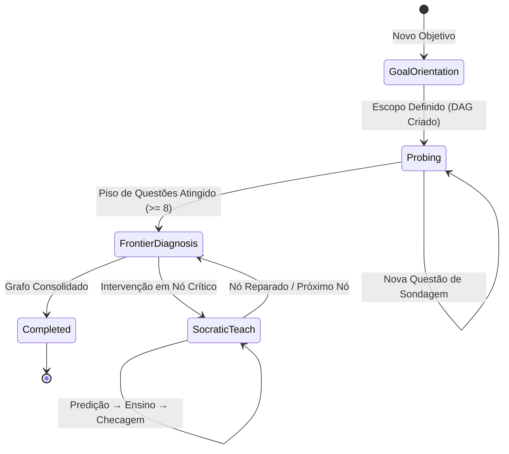

# APRENDA — EduCognitive Agent Harness

> **"Fatos memorizados apodrecem. Fatos compreendidos permanecem."**

O **APRENDA** é um ambiente de aprendizado acelerado e profundo conduzido por agentes de inteligência artificial. Ao contrário de chatbots convencionais que apenas fornecem respostas ou sistemas de flashcards baseados em repetição mecânica, o APRENDA atua como um **tutor socrático cirúrgico**: ele mapeia a exata fronteira do conhecimento do estudante, diagnostica equívocos conceituais ocultos e conduz uma jornada estruturada de descoberta motivada até a consolidação do entendimento.

---

## 🧠 Filosofia Pedagógica e Cognitiva

O design do APRENDA é fundamentado em princípios avançados de ciência cognitiva e pedagogia ativa:

1. **A Fronteira Cognitiva (Medir antes de Ensinar)**:
   - Ensinar o que o estudante já domina é perda de tempo; ensinar além do que ele consegue assimilar gera frustração e evasão.
   - O sistema realiza uma busca binária no espaço conceitual para encontrar o ponto exato onde a compreensão transita de sólida para incerta (a *Fronteira*).
2. **O "Click" Estrutural (Fatos Soltos $\rightarrow$ Estruturas Geradoras)**:
   - O estudante chega com intuições desconectadas. O tutor ancora verdades fundamentais e desenha conexões passo a passo até que essas intuições colapsem em uma estrutura lógica evidente por si mesma.
3. **Princípio I: Verdades Incondicionais Primeiro**:
   - Princípios sólidos, sem ressalvas ou exceções prematuras, que o cérebro pode aceitar com 100% de segurança antes de construir camadas superiores de abstração.
4. **Princípio II: "Como eu poderia ter descoberto isso?"**:
   - Inspirado na abordagem explicativa do *3Blue1Brown* (Grant Sanderson): o conhecimento nunca surge arbitrariamente por decreto. Cada etapa é motivada por um problema concreto anterior.
5. **Eliminação de Falsos Positivos**:
   - Acertar uma questão de múltipla escolha por chute ou eliminação mascara lacunas graves. O APRENDA exige a calibração de certeza (0–100%) e a explicação do raciocínio, permitindo ao Juiz Cognitivo separar domínio genuíno de adivinhações.

---

## 🔄 As 5 Fases da Sessão (Máquina de Estados)

A jornada de aprendizado é governada por uma Máquina de Estados Finitos rigorosa (`SessionStateMachine`):



1. **`goal_orientation` (Orientação de Escopo)**:
   - O estudante digita o que quer aprender (ex.: *"Eu quero aprender sobre TCP/UDP"*).
   - O sistema gera recortes técnicos precisos via IA generativa em tempo real (zero templates fixos) ou permite a digitação de um escopo personalizado.
2. **`probing` (Diagnóstico de Fronteira)**:
   - Apresenta questões conceituais com alternativas dinâmicas, controle deslizante de confiança e campo integrado para explicar o raciocínio.
3. **`frontier_diagnosis` (Diagnóstico Cognitivo)**:
   - Classificação cirúrgica de cada nó do Grafo DAG:
     - 🟢 **Domínio Sólido (`mastered`)**: Acerto com alta confiança e fundamentação conceitual correta.
     - 🟡 **Falso Positivo (`false_positive`)**: Acerto com justificativa frágil, chute ou dedução incorreta.
     - 🔴 **Ponto Cego (`blind_spot`)**: Erro conceitual em fundamento prévio com alta convicção errônea.
     - 🔵 **Fronteira Ativa (`frontier`)**: Próximo nó na borda de assimilação do aluno.
4. **`socratic_teach` (Intervenção Socrática Cirúrgica)**:
   - **Predição**: O aluno formula uma intuição sobre o comportamento de um cenário antes da teoria.
   - **Ensino Motivado**: Explicação concisa fundamentada na verdade incondicional do conceito.
   - **Checagem**: Pergunta de validação prática imediata.
5. **`completed` (Consolidação)**:
   - Visualização do Grafo de Conhecimento totalmente validado e desbloqueado.

---

## 🏗 Arquitetura do Software

O projeto é estruturado em uma arquitetura limpa de 3 camadas com **Electron**, **TypeScript** e **React**:

```
aprenda1/
├── src/
│   ├── main/                  # Processo Principal (Node.js / Electron)
│   │   ├── fsm/               # Máquina de estados (SessionStateMachine)
│   │   ├── ipc/               # Manipuladores de IPC (comunicação segura)
│   │   ├── prompts/           # Prompts doutrinários e metodológicos
│   │   └── services/          # Serviços de IA, LLM e armazenamento
│   │       ├── AgentOrchestrator.ts        # Fila de prioridades e prefetch especulativo
│   │       ├── CognitiveJudgeService.ts    # Juiz cognitivo de respostas e raciocínio
│   │       ├── CurriculumGenerator.ts      # Geração dinâmica do DAG e de questões
│   │       ├── KnowledgeStore.ts           # Repositório em memória e persistência
│   │       ├── llmClient.ts                # Conexão unificada com LLMs e streaming
│   │       ├── providerValidationService.ts# Validação de credenciais e modelos
│   │       └── SocraticEngine.ts           # Mecânica de predição e ensino socrático
│   │
│   ├── preload/               # Context Bridge seguro
│   │   └── preload.ts         # Exposição de window.api para o Renderer
│   │
│   ├── renderer/              # Interface do Usuário (React 18 + Vite + Tailwind)
│   │   ├── components/        # Componentes reutilizáveis
│   │   │   ├── AnsweredQuestionCard.tsx # Histórico de questões respondidas
│   │   │   ├── ConfidenceSlider.tsx     # Slider de confiança (0-100%)
│   │   │   ├── KnowledgeGraph.tsx       # Grafo DAG interativo
│   │   │   ├── NodeDetailModal.tsx      # Detalhes e status do nó cognitivo
│   │   │   ├── QuestionCard.tsx         # Card de alternativas da questão ativa
│   │   │   ├── RichText.tsx             # Código com números de linha + KaTeX math
│   │   │   ├── SettingsModal.tsx        # Configuração de provedores e chaves de API
│   │   │   ├── Sidebar.tsx              # Histórico de sessões e navegação
│   │   │   ├── SocraticCard.tsx         # Card interativo de predição/ensino
│   │   │   ├── StatusBar.tsx            # Tokens, ditado, modelo e nível de thinking
│   │   │   └── TitleBar.tsx             # Barra de título minimalista com controles
│   │   ├── hooks/
│   │   │   └── useSpeechRecognition.ts  # Ditado de voz via Deepgram / Web Speech
│   │   └── views/
│   │       └── SessionView.tsx          # Tela principal do chat e fluxo de aprendizado
│   │
│   └── shared/                # Tipagens TypeScript compartilhadas
│       └── types.ts           # Modelos de dados e contratos de IPC
│
├── tests/                     # Bateria completa de testes automatizados (Vitest)
│   ├── main/                  # Testes unitários do processo principal e serviços
│   └── renderer/              # Testes unitários de componentes e integração de UI
│
├── package.json
├── tailwind.config.js
├── vite.config.ts
└── vitest.config.ts
```

---

## 🎨 Principais Recursos de Interface (UI/UX)

- **Chat Contínuo de Rolagem Única**:
  - Toda a linha do tempo (mensagens do usuário, pensamentos da IA, histórico de perguntas e questão ativa) convive em um fluxo unificado sem scrolls internos truncados.
- **Questão Acoplada ao Input**:
  - A alternativa selecionada e o campo de texto de raciocínio são integrados. Se o aluno digita sem escolher alternativa, o sistema entende como resposta dissertativa própria.
- **Encolhimento Inteligente com Animação Suave**:
  - Ao rolar para cima para revisar mensagens anteriores, a questão ativa encolhe suavemente com animação cúbica (`CSS Grid`).
  - No rodapé, o campo de input é substituído por uma pílula informativa (`[QUESTION] ... Answer ↓`). Clicar na pílula rola a tela de volta e expande a questão e o input.
- **Blocos de Pensamento do Agente (`AgentThinkingBlock`)**:
  - Exibe o raciocínio profundo da IA de forma colapsável, com suporte a streaming em tempo real sem roubar o scroll da tela.
- **Blocos de Código com Numeração e LaTeX**:
  - Blocos de código com destaque de sintaxe, numeração de linhas e fórmulas matemáticas renderizadas via KaTeX.
- **Ditado por Voz (`Dictate`)**:
  - Suporte a entrada por fala através de integração com Deepgram ou Web Speech API.
- **Seletor de Modelos e Nível de Raciocínio (*Thinking*)**:
  - Troca dinâmica de modelos (OpenRouter, Gemini, Groq, OpenAI, Anthropic) com exibição de precificação, limite de contexto e ajuste de esforço de raciocínio (*Off*, *Low*, *Medium*, *High*).

---

## 🛠 Tecnologias Utilizadas

- **Core**: [Electron](https://www.electronjs.org/) + [TypeScript](https://www.typescriptlang.org/) + [Node.js](https://nodejs.org/)
- **Frontend**: [React 18](https://react.dev/) + [Vite](https://vitejs.dev/)
- **Estilização**: [Tailwind CSS](https://tailwindcss.com/) + [Lucide React Icons](https://lucide.dev/)
- **Renderização Matemática e Código**: [KaTeX](https://katex.org/)
- **Testes**: [Vitest](https://vitest.dev/) + [Testing Library (React / Jest-DOM)](https://testing-library.com/) + [JSDOM](https://github.com/jsdom/jsdom)

---

## 🚀 Como Executar o Projeto

### Pré-requisitos
- **Node.js** (v18 ou superior)
- **npm** (v9 ou superior)

### 1. Clonar e Instalar Dependências
```bash
git clone https://github.com/seu-usuario/aprenda1.git
cd aprenda1
npm install
```

### 2. Executar em Modo de Desenvolvimento
Para iniciar o servidor Vite de desenvolvimento do Renderer:
```bash
npm run dev
```

Para compilar e abrir a aplicação desktop no Electron:
```bash
npm run build
npm start
```

### 3. Rodar os Testes Automatizados
O projeto conta com mais de 70 testes automatizados cobrindo tanto serviços de backend quanto componentes visuais:
```bash
npm test
```

### 4. Gerar os instaláveis (Windows e Linux)
```bash
npm run dist:linux   # release/APRENDA-<versão>-linux-x86_64.AppImage
npm run dist:win     # release/APRENDA-<versão>-windows-x64-setup.exe
npm run dist         # os dois
```
No Linux, o instalador de Windows é gerado com o Wine instalado. Os prompts (`prompts/`) vão dentro do pacote, em `resources/prompts`. Os instaláveis não são assinados digitalmente: o Windows pode mostrar o aviso do SmartScreen ("Mais informações → Executar assim mesmo").

### 5. Build de Produção
Para compilar tanto os scripts do processo principal quanto os assets otimizados do renderer:
```bash
npm run build
```

---

## 📄 Licença

Propriedade privada. Desenvolvido para transformar o processo de aprendizado técnico através de rigor epistemológico e inteligência artificial orientada à compreensão.
